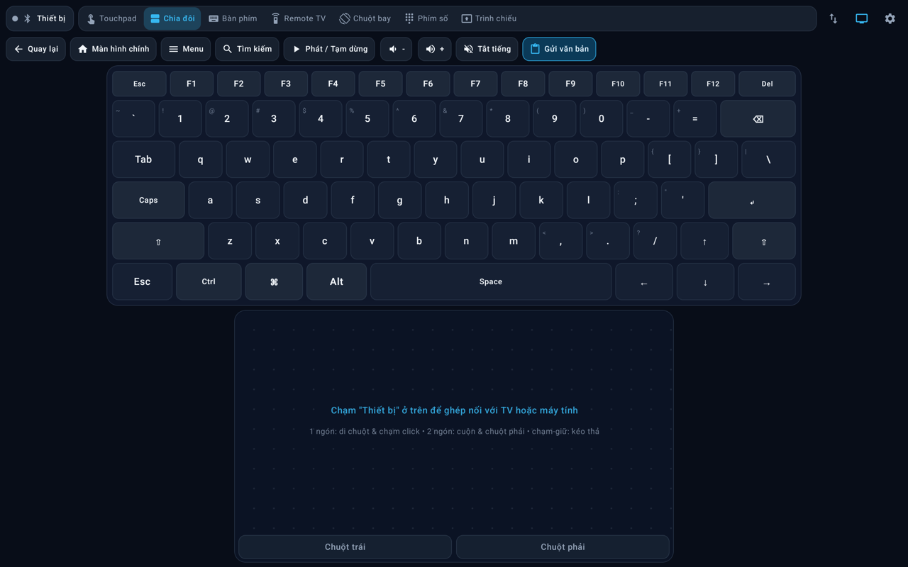
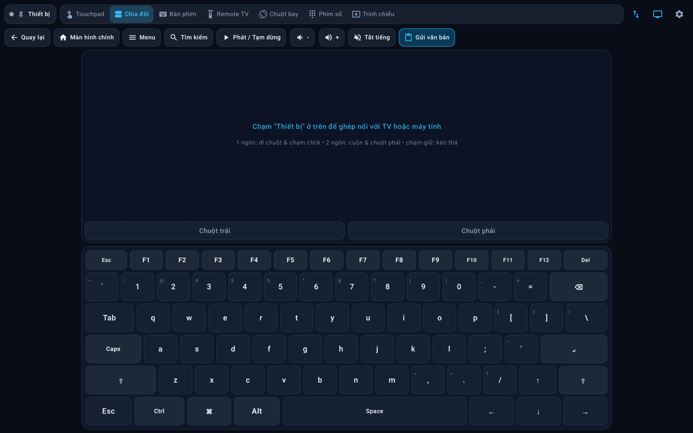
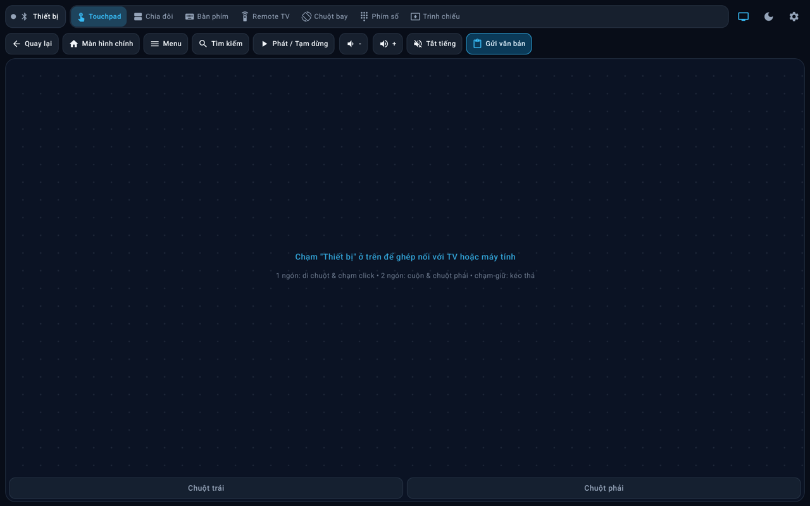
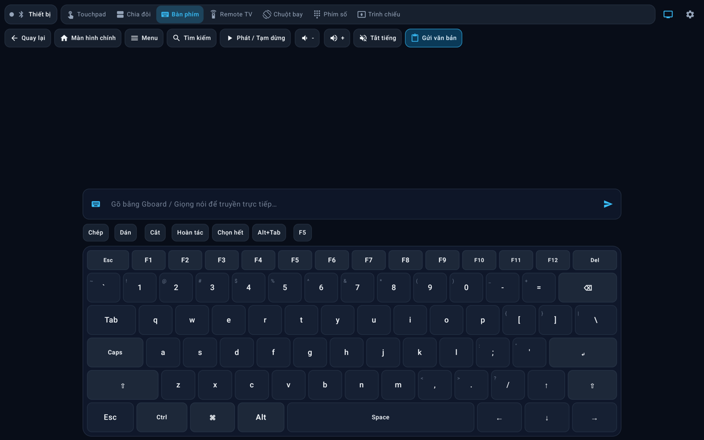
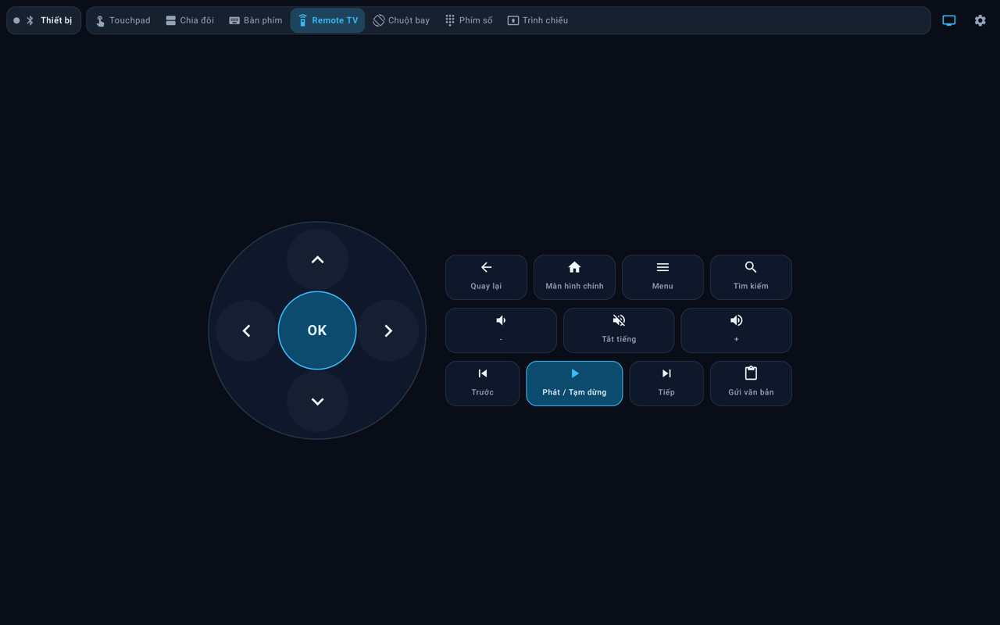
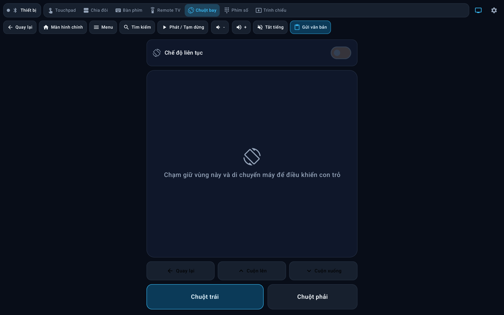
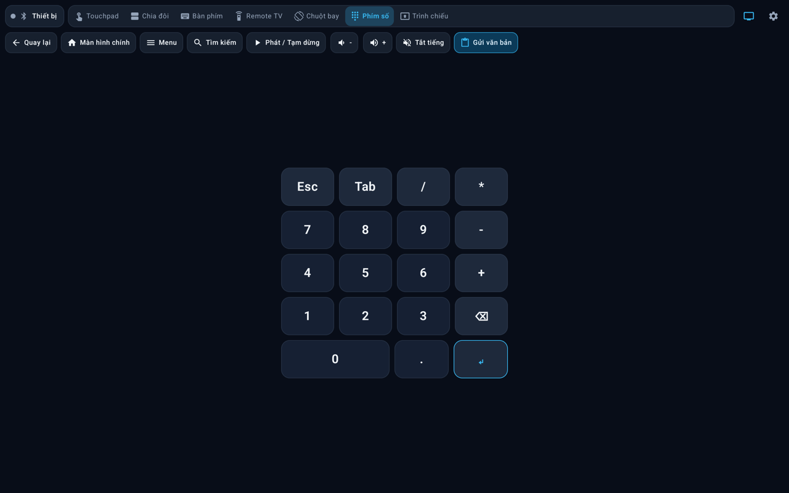
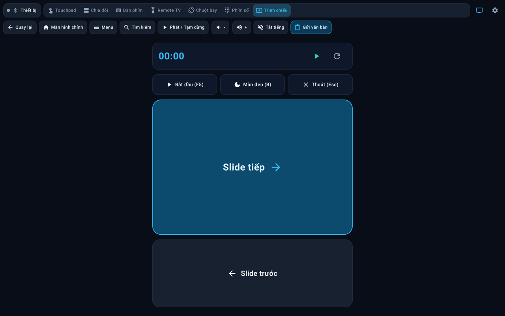

# AirDeck

**English** | [Tiếng Việt](README.vi.md)

**AirDeck** turns your Android phone or tablet into a serverless **Bluetooth HID wireless keyboard, multi-touch trackpad, Smart TV remote, gyroscope air mouse, numpad, and presentation clicker** — with **no companion app, no server software, and no root** required on the target device.

Pair it directly over standard Bluetooth with Smart TVs (Samsung Tizen, LG webOS, Android TV / Google TV), Windows, macOS, Linux, ChromeOS, iPadOS, Steam Deck, or another Android device.

[](LICENSE)
[-3DDC84.svg)](app/build.gradle.kts)
[](build.gradle.kts)
[](app/build.gradle.kts)

---

## Screenshots

| Split Mode — Laptop Layout (Keyboard Top) | Split Mode — Handheld Layout (Touchpad Top) |
| :---: | :---: |
|  |  |

| Fullscreen Touchpad | Keyboard + Live IME & Shortcuts |
| :---: | :---: |
|  |  |

| Smart TV Remote (D-Pad + Media) | Gyroscope Air Mouse |
| :---: | :---: |
|  |  |

| Numpad | Slide Presenter |
| :---: | :---: |
|  |  |

---

## Features

### 7 Switchable Input Modes
- **Touchpad** — Full-screen precision trackpad (DeX-style) with acceleration, 1-finger tap left-click, 2-finger tap right-click, 2-finger smooth scroll, double-tap-and-hold drag lock, 3-finger middle-click, optional Left/Right click buttons, and **OLED Dim/Blackout mode** for dark rooms.
- **Split (Keyboard + Touchpad)** — Ergonomic laptop-style layout combining a proportional virtual keyboard and trackpad on one screen, with a **1-tap Top/Bottom Swap** (`Keyboard on top / Touchpad below` or `Touchpad on top / Keyboard below`).
- **Keyboard** — Proportional laptop keyboard (never stretched across tall screens) with sticky modifiers (`Shift`, `Ctrl`, `Alt`, `⌘/Win`), `Caps Lock`, key repeat on hold, a **Quick Shortcuts bar** (`Copy`, `Paste`, `Cut`, `Undo`, `Select All`, `Alt+Tab`, `F5`), and a **Live IME bar** to stream Gboard swipe-typing or Voice-to-Text directly over Bluetooth HID.
- **TV Remote** — Large circular D-Pad with hold-to-repeat + `OK`, `Back`, `Home`, `Menu`, `Search`, `Volume +/-`, `Mute`, `Previous / Play-Pause / Next`, and Quick Text paste for Smart TVs.
- **Air Mouse** — Gyroscope-powered pointer (Magic Remote style) with Hold-to-Aim pad, Continuous mode toggle, deadzone tremor filtering, Left/Right click triggers, and Scroll buttons.
- **Numpad** — Centered calculator-style numeric keypad (`0–9`, `+ - * / .`, `Tab`, `Esc`, `Backspace`, `Enter`).
- **Presenter** — Oversized **Next / Previous Slide** buttons, `Start (F5)`, `Blackout (B)`, `Exit (Esc)`, and a built-in presentation timer.

### Technical Highlights
- **Native Bluetooth HID (`BluetoothHidDevice`)** — Composite USB HID descriptor exposing 3 reports:
  1. **Report ID 1:** Standard 6-key rollover Keyboard (8 bytes)
  2. **Report ID 2:** Standard Relative Mouse — 3 buttons, X, Y, vertical scroll wheel (4 bytes)
  3. **Report ID 3:** Consumer Control — 16-bit Smart TV & media usages (2 bytes)
- **Adaptive & Responsive UI** — Automatically picks **Split** on tablets/wide screens and **Touchpad** on compact phones, with instant manual switching.
- **Zero Location Permission** — Uses Android 12+ `BLUETOOTH_CONNECT`, `BLUETOOTH_ADVERTISE`, and `BLUETOOTH_SCAN` (`neverForLocation`).
- **Foreground Session Service** — Keeps active Bluetooth HID connections stable when the screen dims or you briefly switch apps, with a quick Disconnect notification action.
- **Bilingual UI** — English (default) and Vietnamese (`vi`).

---

## Requirements

- **Android 10+ (API 29)** with Classic Bluetooth HID Device profile support (`BluetoothHidDevice`).
- **Host device:** Any Smart TV, PC, Mac, Linux machine, tablet, or console that supports standard Bluetooth keyboards/mice.

> **Notes:**
> - Some budget Android ROMs disable the Bluetooth HID Device profile at the system level; AirDeck detects this at runtime and notifies you.
> - Because Bluetooth HID sends physical US-QWERTY keycodes, accented input (such as Vietnamese Telex/VNI) depends on the input method configured on the host TV/PC.
> - On some Smart TVs (e.g., Samsung Tizen), the mouse cursor is only shown in pointer-enabled apps (such as the web browser or settings); use **TV Remote** mode for full D-Pad navigation everywhere.

---

## Quick Start (Pairing with a Smart TV or PC)

1. Open **AirDeck** and grant Bluetooth permissions.
2. Tap **Devices** in the top-left corner and tap **Make visible to TV (2 min)**.
3. On your Smart TV or computer, open **Bluetooth Settings → Add device / Add accessory** and select your phone/tablet.
4. Once paired, tap the host name in AirDeck's **Devices** list anytime to reconnect.

---

## Building from Source

### Prerequisites
- JDK 17
- Android SDK (API 36)

### Build & Test
```bash
git clone https://github.com/compasify/AirDeck.git
cd AirDeck

# Run unit tests (HID descriptor & keymap verification)
./gradlew testDebugUnitTest

# Build debug APK
./gradlew assembleDebug
```

The debug APK is generated at `app/build/outputs/apk/debug/app-debug.apk`.

---

## Project Structure

```text
app/src/main/java/dev/airdeck/
├── AirDeckApp.kt                   # Application singleton (prefs & HID controller)
├── MainActivity.kt                 # Immersive fullscreen activity & Bluetooth intents
├── data/
│   └── AirDeckPrefs.kt             # DataStore preferences (speed, layout, swap state)
├── hid/
│   ├── HidDescriptor.kt            # Composite USB HID descriptor & report builders
│   ├── HidKeyMap.kt                # Android KeyCode & ASCII -> USB HID Usage map
│   ├── BluetoothHidController.kt   # BluetoothHidDevice lifecycle & input dispatch
│   └── AirDeckHidService.kt        # Connected-device foreground service
└── ui/
    ├── AirDeckTheme.kt             # OLED-friendly dark Material 3 theme
    ├── AirDeckScreen.kt            # Adaptive top bar & 7-mode workspace shell
    ├── TouchpadSurface.kt          # Multi-touch trackpad & OLED blackout mode
    ├── VirtualKeyboard.kt          # Proportional laptop virtual keyboard
    ├── ShortcutAndImeBar.kt        # Quick macro bar & live Gboard/Voice IME bridge
    ├── TvControlBar.kt             # Collapsible TV media strip
    ├── TvRemoteScreen.kt           # Circular D-Pad & Smart TV remote
    ├── AirMouseScreen.kt           # Gyroscope Air Mouse controller
    ├── NumpadAndPresenterScreens.kt# Numpad & slide presenter with timer
    └── DeviceAndSettingsSheets.kt  # Bluetooth device picker, settings, quick text
```

---

## Contributing

Contributions, bug reports, and pull requests are welcome! Please open an issue first for major changes.

## License

This project is licensed under the **MIT License** — see the [LICENSE](LICENSE) file for details.
