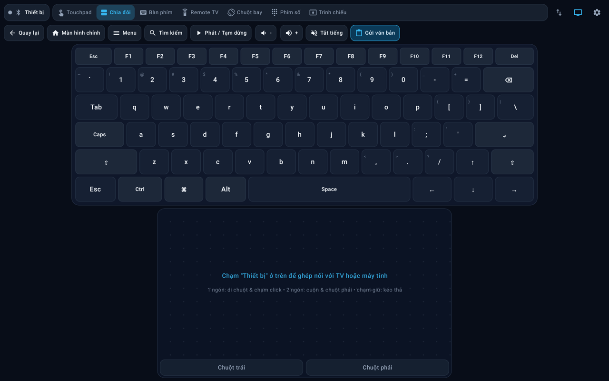
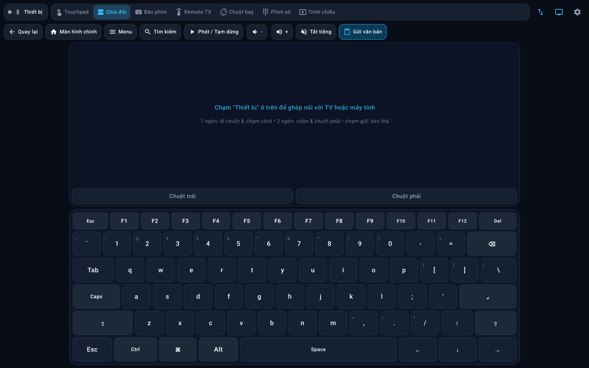
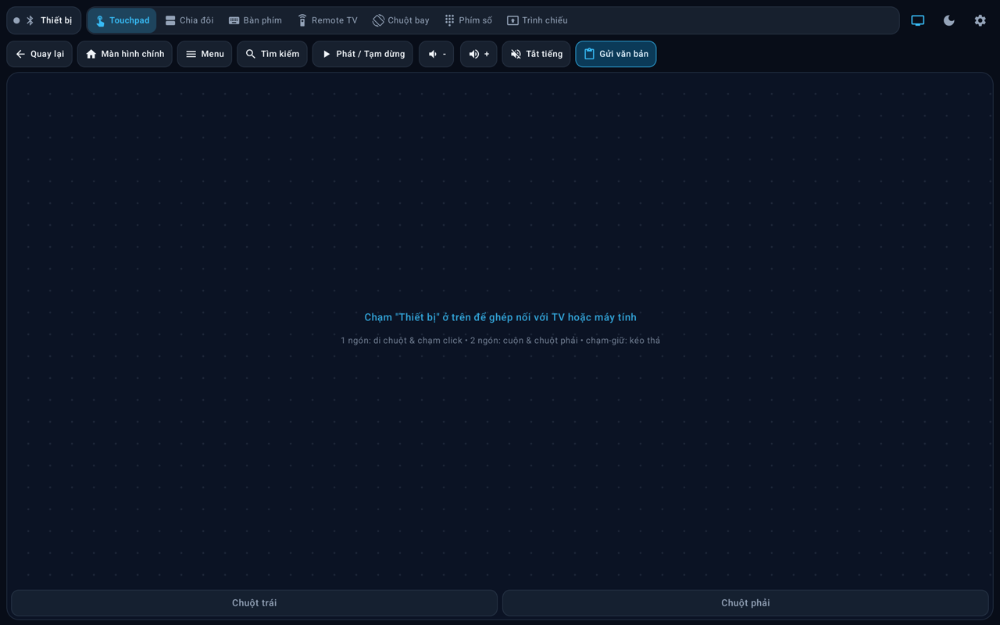
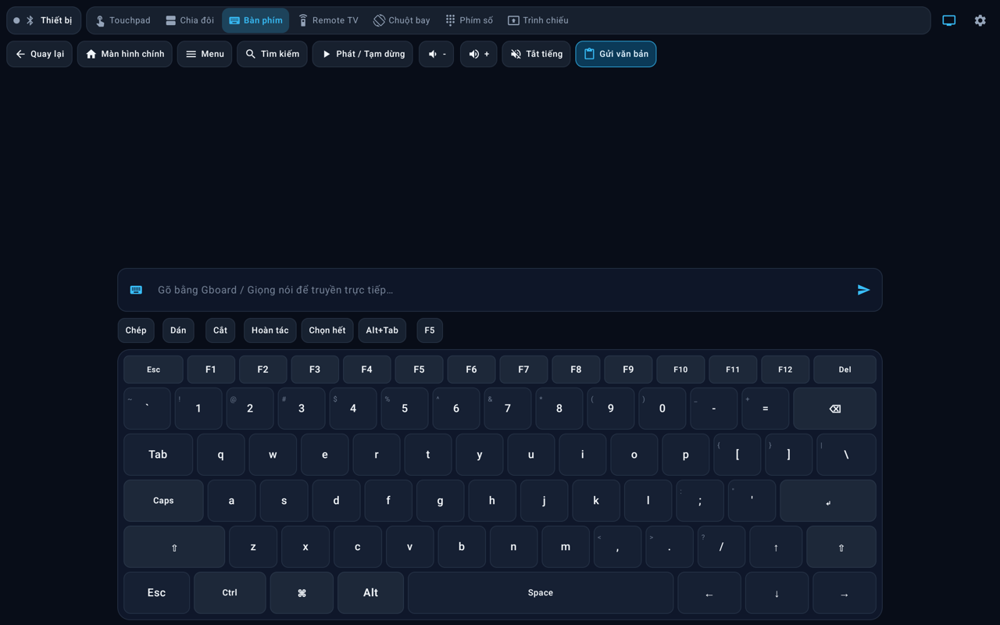
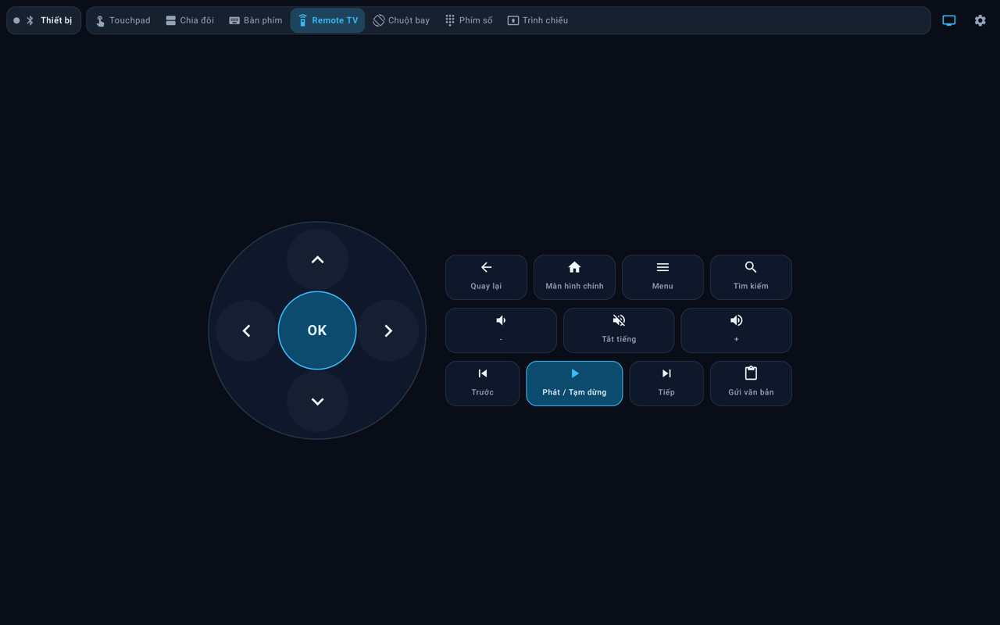
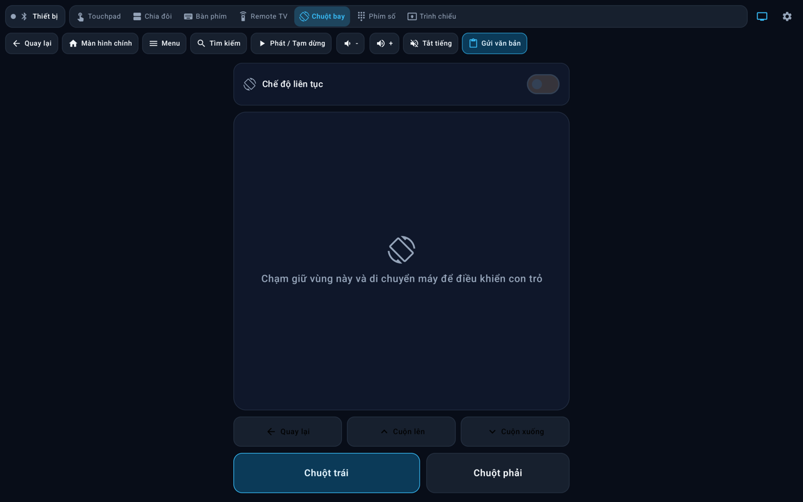
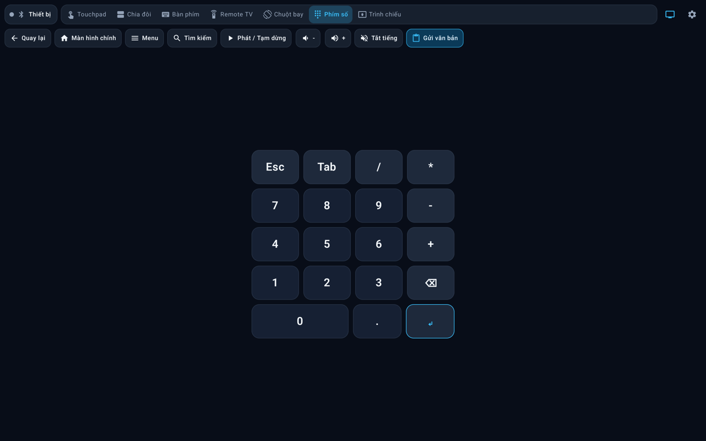
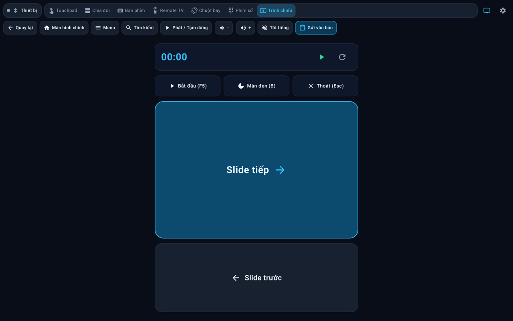

# AirDeck

[English](README.md) | **Tiếng Việt**

**AirDeck** biến điện thoại hoặc máy tính bảng Android của bạn thành **bàn phím không dây, touchpad đa điểm, điều khiển Smart TV, chuột bay (Air Mouse), bàn phím số và bút trình chiếu qua Bluetooth HID** — **không cần cài ứng dụng phụ, không cần server và không cần root** trên thiết bị đích.

Kết nối trực tiếp qua Bluetooth chuẩn với Smart TV (Samsung Tizen, LG webOS, Android TV / Google TV), Windows, macOS, Linux, ChromeOS, iPadOS, Steam Deck hoặc thiết bị Android khác.

[](LICENSE)
[-3DDC84.svg)](app/build.gradle.kts)
[](build.gradle.kts)
[](app/build.gradle.kts)

---

## Ảnh chụp màn hình

| Chia đôi — Kiểu Laptop (Bàn phím trên) | Chia đôi — Kiểu Cầm tay (Touchpad trên) |
| :---: | :---: |
|  |  |

| Touchpad toàn màn hình | Bàn phím + Live IME & Phím tắt |
| :---: | :---: |
|  |  |

| Remote TV (D-Pad + Media) | Chuột bay (Air Mouse) |
| :---: | :---: |
|  |  |

| Phím số (Numpad) | Trình chiếu (Presenter) |
| :---: | :---: |
|  |  |

---

## Tính năng nổi bật

### 7 chế độ điều khiển chuyển đổi nhanh
- **Touchpad** — Bàn di chuột toàn màn hình (kiểu Samsung DeX) có gia tốc mượt, chạm 1 ngón click trái, chạm 2 ngón click phải, kéo 2 ngón cuộn trang, chạm đúp-giữ để kéo thả (drag lock), chạm 3 ngón click giữa, thanh nút Chuột trái/phải bật tắt linh hoạt, và chế độ **Làm tối màn hình OLED** tiết kiệm pin khi dùng trong phòng tối.
- **Chia đôi (Bàn phím + Touchpad)** — Bố cục chuẩn laptop kết hợp bàn phím tỉ lệ thật và touchpad trên cùng màn hình, kèm nút **đổi vị trí 1 chạm (`⇅`)** giữa **Bàn phím ở trên – Touchpad ở dưới** (kiểu laptop) và **Touchpad ở trên – Bàn phím ở dưới** (kiểu cầm tay).
- **Bàn phím (Keyboard)** — Bàn phím laptop chuẩn tỉ lệ (không bị kéo giãn theo chiều cao màn hình), hỗ trợ phím bổ trợ nhấn-1-lần (`Shift`, `Ctrl`, `Alt`, `⌘/Win`), `Caps Lock`, giữ phím để lặp, **Thanh phím tắt nhanh** (`Chép`, `Dán`, `Cắt`, `Hoàn tác`, `Chọn hết`, `Alt+Tab`, `F5`), và ô **Gõ trực tiếp (Live IME)** giúp dùng Gboard / lướt phím / nhập giọng nói truyền thẳng sang TV/PC.
- **Remote TV** — Cụm **D-Pad tròn lớn + nút OK** (giữ phím để cuộn liên tục), cùng các phím `Quay lại`, `Màn hình chính`, `Menu`, `Tìm kiếm`, `Âm lượng +/-`, `Tắt tiếng`, `Trước / Phát-Tạm dừng / Tiếp` và dán nhanh văn bản cho Smart TV.
- **Chuột bay (Air Mouse)** — Điều khiển con trỏ bằng cảm biến **con quay hồi chuyển (Gyroscope)** giống LG Magic Remote: chạm giữ để di chuyển hoặc bật chế độ liên tục, lọc rung tay, nút Chuột trái/phải lớn và nút Cuộn lên/xuống.
- **Phím số (Numpad)** — Bàn phím số dạng máy tính căn giữa (`0–9`, `+ - * / .`, `Tab`, `Esc`, `Backspace`, `Enter`).
- **Trình chiếu (Presenter)** — Nút **Slide tiếp / Slide trước** cỡ lớn, `Bắt đầu (F5)`, `Màn đen (B)`, `Thoát (Esc)` và đồng hồ bấm giờ tích hợp.

### Điểm nhấn kỹ thuật
- **Bluetooth HID chuẩn hệ thống (`BluetoothHidDevice`)** — Composite USB HID Descriptor gồm 3 report:
  1. **Report ID 1:** Bàn phím chuẩn 6-key rollover (8 byte)
  2. **Report ID 2:** Chuột tương đối chuẩn — 3 nút, trục X/Y, con lăn dọc (4 byte)
  3. **Report ID 3:** Consumer Control — mã phím điều khiển Smart TV & Media 16-bit (2 byte)
- **Giao diện thích ứng (Adaptive UI)** — Tự động chọn chế độ **Chia đôi** trên tablet/màn hình rộng và **Touchpad** trên điện thoại nhỏ gọn, dễ dàng chuyển chế độ bất cứ lúc nào.
- **Không yêu cầu quyền Vị trí (Location)** — Dùng bộ quyền Bluetooth mới trên Android 12+ (`BLUETOOTH_CONNECT`, `BLUETOOTH_ADVERTISE`, `BLUETOOTH_SCAN` với `neverForLocation`).
- **Foreground Service giữ kết nối** — Duy trì phiên Bluetooth HID ổn định khi làm tối màn hình hoặc chuyển app tạm thời, có nút Ngắt kết nối nhanh ngay trên thanh thông báo.
- **Hỗ trợ song ngữ** — Tiếng Anh (mặc định) và Tiếng Việt (`vi`).

---

## Yêu cầu hệ thống

- **Android 10 trở lên (API 29+)** có hỗ trợ Bluetooth HID Device profile (`BluetoothHidDevice`).
- **Thiết bị đích:** Mọi Smart TV, máy tính Windows/macOS/Linux, máy tính bảng hoặc thiết bị hỗ trợ bàn phím/chuột Bluetooth chuẩn.

> **Lưu ý:**
> - Một số bản ROM Android giá rẻ có thể tắt Bluetooth HID Device profile ở tầng hệ thống; AirDeck sẽ tự kiểm tra lúc chạy và thông báo rõ.
> - Do Bluetooth HID gửi mã phím vật lý chuẩn US QWERTY, việc gõ tiếng Việt có dấu phụ thuộc vào bộ gõ đang bật trên TV/PC (như Telex/VNI).
> - Trên một số dòng Smart TV (ví dụ Samsung Tizen), con trỏ chuột chỉ hiển thị trong ứng dụng hỗ trợ chuột (như Trình duyệt Web hoặc Cài đặt); bạn có thể chuyển sang chế độ **Remote TV** để điều hướng D-Pad ở mọi màn hình.

---

## Hướng dẫn kết nối nhanh với TV / PC

1. Mở **AirDeck** và cấp quyền Bluetooth.
2. Chạm nút **Thiết bị** ở góc trên bên trái → chọn **Cho phép TV tìm thấy (2 phút)**.
3. Trên Smart TV hoặc máy tính: vào **Cài đặt Bluetooth → Thêm thiết bị / Thêm phụ kiện** rồi chọn tên điện thoại/tablet của bạn.
4. Sau lần ghép nối đầu tiên, các lần sau chỉ cần chạm vào tên thiết bị trong mục **Thiết bị** của AirDeck để kết nối lại ngay.

---

## Biên dịch từ mã nguồn

### Yêu cầu môi trường
- JDK 17
- Android SDK (API 36)

### Chạy test & build APK
```bash
git clone https://github.com/compasify/AirDeck.git
cd AirDeck

# Chạy unit test (kiểm tra HID descriptor & bảng mã phím)
./gradlew testDebugUnitTest

# Build file APK debug
./gradlew assembleDebug
```

File APK sau khi build nằm tại `app/build/outputs/apk/debug/app-debug.apk`.

---

## Dự án liên quan

- **[OpenDex](https://github.com/compasify/OpenDex)** — Không gian làm việc chế độ Desktop mã nguồn mở cho Android với thanh tác vụ (taskbar), cửa sổ ứng dụng tự do (free-form) và hỗ trợ đầy đủ cả màn hình trên máy, màn hình ngoài qua USB-C/HDMI lẫn truyền không dây Wi-Fi Cast. Kết hợp **AirDeck** cùng màn hình ngoài hoặc Android TV chạy **OpenDex** để có trọn bộ trải nghiệm desktop không dây.
- **[Media Float Button](https://github.com/compasify/media-float-button)** — Cụm nút nổi tua lùi, tua tiến và phát/tạm dừng cho video web trên máy tính bảng và điện thoại Android, tùy chỉnh bước tua theo giây, độ trong suốt, kích thước cùng widget và thông báo bật/tắt nhanh.

---

## Đóng góp

Mọi đóng góp, báo lỗi (Issue) và Pull Request đều được hoan nghênh!

## Giấy phép

Dự án được phát hành theo giấy phép **MIT License** — xem chi tiết tại file [LICENSE](LICENSE).
